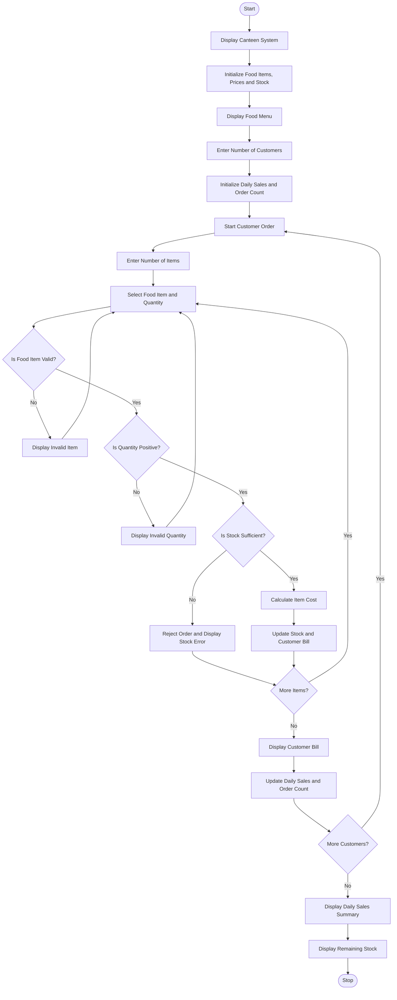

Smart Canteen Order and Stock Management System

1. Problem Statement

Develop a Python program called Smart Canteen Order and Stock Management System to manage customer orders, calculate bills, update food inventory, and generate daily sales reports.

The program should:
- Store food item names, prices, and available stock quantities.
- Display the available food menu with prices and stock.
- Accept successive customer orders.
- Allow customers to select food items and specify quantities.
- Calculate the total bill for each customer.
- Check whether the requested quantity is available in stock.
- Reject orders when the requested quantity exceeds available stock.
- Automatically update inventory after successful orders.
- Calculate total daily sales and the number of successful orders.
- Display the remaining stock of each food item at the end of the day.
- Handle invalid item selections and quantities.

2. Algorithm

  
1. Start the program.
2. Display the Smart Canteen Order and Stock Management System title.
3. Initialize the food inventory with:
   - Food item name
   - Price per item
   - Available stock
4. Display the available food menu.
5. Ask the user to enter the number of customers.
6. For each customer:
   - Initialize the customer's bill to zero.
   - Ask for the number of items to order.
   - Accept the food item name and required quantity.
7. Check whether the selected food item exists.
8. Check whether the requested quantity is positive.
9. Compare the requested quantity with available stock.
10. If stock is insufficient, reject the order and display an error message.
11. If stock is available:
    - Calculate the item cost.
    - Add the cost to the customer's bill.
    - Reduce the available stock.
12. Display the customer's final bill.
13. Add the customer's bill to total daily sales.
14. Repeat until all customers' orders are processed.
15. Calculate the total successful orders.
16. Display the daily sales summary.
17. Display the remaining inventory.
18. Stop the program.

Sample input
SMART CANTEEN ORDER AND STOCK MANAGEMENT
-----------------------------------------

AVAILABLE FOOD MENU

1. Idli      - Rs. 30  - Stock: 20
2. Dosa      - Rs. 50  - Stock: 15
3. Fried Rice - Rs. 80 - Stock: 10
4. Burger    - Rs. 60  - Stock: 12

Enter number of customers: 2

CUSTOMER 1

Enter number of items: 2

Enter food item: Idli
Enter quantity: 2

Enter food item: Dosa
Enter quantity: 1

CUSTOMER 2

Enter number of items: 2

Enter food item: Burger
Enter quantity: 2

Enter food item: Fried Rice
Enter quantity: 15

Sample output
SMART CANTEEN CUSTOMER BILL
-----------------------------------------

CUSTOMER 1

Item          Quantity     Price
Idli             2          Rs. 60
Dosa             1          Rs. 50

Total Bill: Rs. 110
Order Status: SUCCESSFUL

CUSTOMER 2

Item          Quantity     Price
Burger           2          Rs. 120

WARNING!
Requested quantity of Fried Rice: 15
Available stock: 10

Order Rejected! Insufficient Stock.

Total Bill: Rs. 120
Order Status: PARTIALLY SUCCESSFUL

=========================================
DAILY SALES SUMMARY
=========================================

Total Customers: 2
Successful Customer Orders: 2
Total Daily Sales: Rs. 230

REMAINING STOCK
-----------------------------------------
Food Item        Remaining Stock
Idli                  18
Dosa                  14
Fried Rice            10
Burger                10

=========================================
CANTEEN MANAGEMENT COMPLETED!
Thank You!
