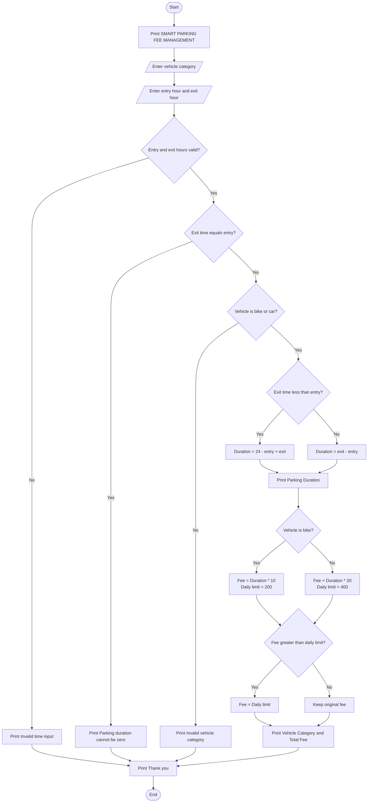

SMART PARKING FEE MANAGEMENT

Problem Statement:

Develop a Python program to calculate parking fees based on vehicle category, entry time, and exit time. The program should calculate parking duration, apply different charges for bikes and cars, handle overnight parking, enforce daily parking limits, and validate time inputs. It should also calculate penalties for invalid parking conditions and display the final parking fee.

Algorithm:

1. Start the program.
2. Input the vehicle category (bike or car).
3. Input the entry hour and exit hour.
4. Validate the entry and exit times (0–23).
5. If the time inputs are invalid, display an error message.
6. If entry and exit times are equal, display that parking duration cannot be zero.
7. Calculate parking duration.
8. If the exit time is earlier than the entry time, consider overnight parking.
9. Calculate parking charges based on vehicle category.
10. Apply the daily parking limit.
11. Calculate the final parking fee.
12. Display the vehicle category, parking duration, and total fee.
13. Stop the program.

    
Sample input:

SMART PARKING FEE MANAGEMENT

Enter vehicle category (bike/car): car
Enter entry hour (0-23): 20
Enter exit hour (0-23): 5

Sample output:

SMART PARKING FEE MANAGEMENT

Parking Duration: 9 hours
Vehicle Category: car
Total Parking Fee: Rs. 180

Thank you!
