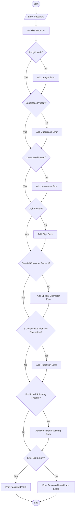

Password Policy Validation Engine

1. Problem Statement

Develop a Python program called Password Policy Validation Engine to evaluate whether a given password satisfies predefined security policies.

The system should check the following conditions:
1. Minimum Length: Password must contain at least 8 characters.
2. Character Categories: Password must contain at least one uppercase letter, one lowercase letter, one digit and one special character.
3. Repetition Rule: Password must not contain three or more consecutive identical characters.
4. Prohibited Substrings: Password must not contain prohibited words such as password, admin, or 123456.
The program should display whether the password is valid or invalid. If invalid, it should explain each failed condition separately.

2. Algorithm

 
1. Start the program.
2. Read the password from the user.
3. Initialize a list to store validation errors.
4. Check whether the password contains at least 8 characters.
5. Check whether it contains at least one uppercase letter.
6. Check whether it contains at least one lowercase letter.
7. Check whether it contains at least one digit.
8. Check whether it contains at least one special character.
9. Check whether three or more consecutive characters are identical.
10. Check whether the password contains prohibited substrings such as password, admin, or 123456.
11. If any condition fails, add the corresponding error message to the list.
12. If the error list is empty, display Password is Valid.
13. Otherwise, display Password is Invalid and print all failed conditions.
14. Stop the program.

Sample input
Enter password: abc123

Sample output
Enter password: abc123

PASSWORD VALIDATION REPORT

Status: INVALID

Failed Conditions:
1. Password must contain at least 8 characters.
2. At least one uppercase letter is required.
3. At least one special character is required.

Thank you!

    
