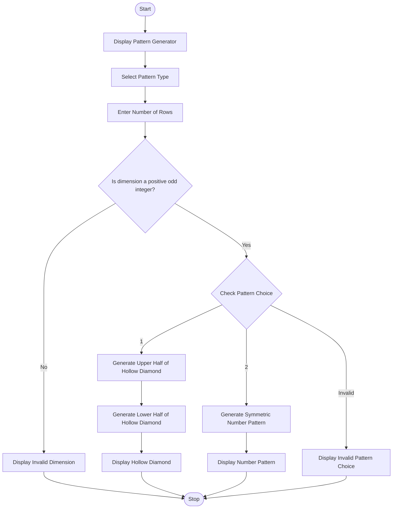

Advanced Numeric Pattern Generator

1. Problem Statement

Develop a Python program called Advanced Numeric Pattern Generator that generates a hollow diamond or symmetric numerical pattern based on the dimensions entered by the user.

The program should:
- Allow the user to select a pattern type (Hollow Diamond or Symmetric Number Pattern).
- Accept the required dimension (number of rows) from the user.
- Validate the input to ensure the dimension is a positive odd integer.
- Display an error message for invalid dimensions.
- Generate the selected pattern with proper spacing and alignment.
- Ensure the output is symmetrical and visually clear.

  
2. Algorithm

  
1. Start the program.
2. Display the pattern generator title.
3. Ask the user to select a pattern:
   - 1 – Hollow Diamond
   - 2 – Symmetric Number Pattern
4. Read the number of rows from the user.
5. Check whether the entered dimension is a positive odd integer.
6. If the dimension is invalid, display an error message and stop.
7. If the selected pattern is Hollow Diamond:
   - Generate the upper half of the diamond using spaces and stars.
   - Generate the lower half using spaces and stars.
   - Display the hollow diamond.
8. If the selected pattern is Symmetric Number Pattern:
   - Generate increasing numbers in the first half.
   - Generate decreasing numbers in the second half.
   - Maintain proper spacing and alignment.
9. If the pattern choice is invalid, display an error message.
10. Stop the program.

Sample input
ADVANCED NUMERIC PATTERN GENERATOR

1. Hollow Diamond
2. Symmetric Number Pattern

Enter your choice: 1
Enter number of rows: 5

Sample output
    *
   * *
  *   *
 *     *
*       *
 *     *
  *   *
   * *
    *
