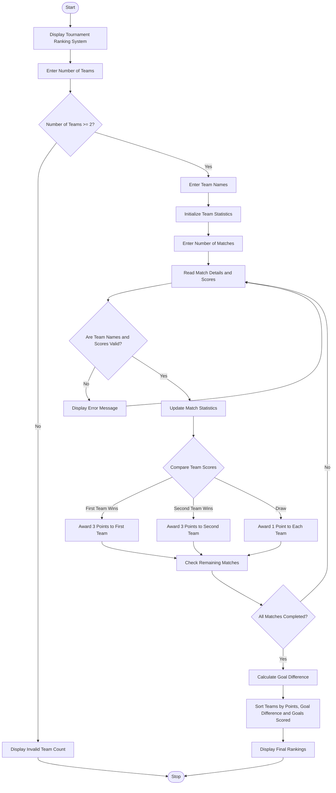

Sports Tournament Ranking System

1. Problem Statement

Develop a Python program called Sports Tournament Ranking System to manage sports tournament results and generate team rankings based on their match performance.

The program should:
- Accept the number of teams participating in the tournament.
- Store team names and match results.
- Record the scores of each team in every match.
- Award points based on the competition policy:
  - Win = 3 points
  - Draw = 1 point
  - Loss = 0 points
- Calculate each team's total points.
- Calculate tie-break values using goal difference (Goals Scored − Goals Conceded).
- Rank teams based on the following rules:
  1. Higher total points.
  2. Higher goal difference.
  3. Higher total goals scored.
- Display the final tournament rankings with team names, matches played, wins, draws, losses, total points, and goal difference.
- Validate inputs and display appropriate error messages for invalid match scores or team names.

2. Algorithm

  
1. Start the program.
2. Display the Sports Tournament Ranking System title.
3. Ask the user to enter the number of participating teams.
4. Validate the number of teams (minimum 2).
5. Read and store all team names.
6. Initialize each team's statistics:
   - Matches played = 0
   - Wins = 0
   - Draws = 0
   - Losses = 0
   - Goals scored = 0
   - Goals conceded = 0
   - Points = 0
7. Ask the user to enter the number of matches.
8. Read the two participating team names and their scores for each match.
9. Validate team names and scores.
10. Update match statistics for both teams.
11. Award points:
    - If the first team wins, award 3 points to the first team.
    - If the second team wins, award 3 points to the second team.
    - If the match is a draw, award 1 point to each team.
12. Calculate goal difference for every team:
    
    Goal Difference = Goals Scored − Goals Conceded
13. Sort the teams according to:
    - Total points (descending).
    - Goal difference (descending).
    - Goals scored (descending).
14. Display the final tournament ranking table.
15. Stop the program.

Sample input
SPORTS TOURNAMENT RANKING SYSTEM
--------------------------------

Enter number of teams: 4

Enter team names:
Team 1: India
Team 2: Australia
Team 3: England
Team 4: Pakistan

Enter number of matches: 4

Match 1:
Enter first team: India
Enter second team: Australia
Enter India score: 3
Enter Australia score: 1

Match 2:
Enter first team: England
Enter second team: Pakistan
Enter England score: 2
Enter Pakistan score: 2

Match 3:
Enter first team: India
Enter second team: England
Enter India score: 1
Enter England score: 1

Match 4:
Enter first team: Australia
Enter second team: Pakistan
Enter Australia score: 2
Enter Pakistan score: 0

Sample output
SPORTS TOURNAMENT FINAL RANKINGS
------------------------------------------------------------
Rank  Team        MP   W   D   L   GF   GA   GD   Points
------------------------------------------------------------
1     India        2   1   1   0    4    2    2      4
2     Australia    2   1   0   1    3    3    0      3
3     England      2   0   1   1    3    3    0      1
4     Pakistan     2   0   1   1    2    4   -2      1
------------------------------------------------------------

Winner: India

Thank you!
