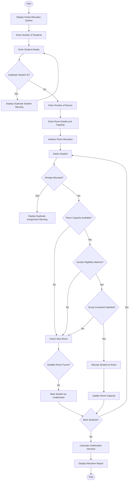

University Hostel Room Allocation System

1. Problem Statement

Develop a Python program called University Hostel Room Allocation System to allocate students to available hostel rooms based on room capacity, eligibility criteria, and specified grouping constraints.

The program should:
- Accept student details such as student ID, name, and gender.
- Accept room details such as room number, capacity, and eligible gender.
- Allocate students only to rooms that match their eligibility.
- Ensure that room capacity is not exceeded.
- Allocate students belonging to the same group together whenever possible.
- Detect and prevent duplicate student assignments.
- Identify students who could not be allocated a room.
- Calculate the total unallocated student demand.
- Display the final room allocation details and available vacancies.

2. Algorithm

   
1. Start the program.
2. Display the University Hostel Room Allocation System title.
3. Ask the user to enter the number of students.
4. Read student details:
   - Student ID
   - Student name
   - Gender
   - Group ID
5. Check for duplicate student IDs.
6. Ask the user to enter the number of available rooms.
7. Read room details:
   - Room number
   - Room capacity
   - Eligible gender
8. Initialize all rooms as empty.
9. Start allocating students to rooms.
10. Check whether the room has sufficient capacity.
11. Check whether the student's gender matches the room eligibility.
12. Check whether the student's group can be accommodated together.
13. If all conditions are satisfied:
    - Allocate the student to the room.
    - Update the room's available capacity.
14. If the student is already allocated, display a duplicate assignment warning.
15. If no suitable room is available, keep the student unallocated.
16. Calculate the total number of unallocated students.
17. Display the final room allocation report.
18. Display available vacancies and unallocated student details.
19. Stop the program.

Sample input
UNIVERSITY HOSTEL ROOM ALLOCATION SYSTEM
----------------------------------------

Enter number of students: 5

Enter student details:

Student 1:
Student ID: 101
Name: Avinesh
Gender: Male
Group: A

Student 2:
Student ID: 102
Name: Rahul
Gender: Male
Group: A

Student 3:
Student ID: 103
Name: Kiran
Gender: Male
Group: B

Student 4:
Student ID: 104
Name: Sita
Gender: Female
Group: C

Student 5:
Student ID: 105
Name: Priya
Gender: Female
Group: C

Enter number of rooms: 3

Enter room details:

Room 1:
Room Number: R101
Capacity: 2
Eligible Gender: Male

Room 2:
Room Number: R102
Capacity: 1
Eligible Gender: Male

Room 3:
Room Number: R103
Capacity: 2
Eligible Gender: Female

Sample output
UNIVERSITY HOSTEL ROOM ALLOCATION REPORT
------------------------------------------------

Room Number: R101
Eligible Gender: Male
Room Capacity: 2
Allocated Students:
101 - Avinesh (Group A)
102 - Rahul (Group A)
Available Vacancies: 0

------------------------------------------------

Room Number: R102
Eligible Gender: Male
Room Capacity: 1
Allocated Students:
103 - Kiran (Group B)
Available Vacancies: 0

------------------------------------------------

Room Number: R103
Eligible Gender: Female
Room Capacity: 2
Allocated Students:
104 - Sita (Group C)
105 - Priya (Group C)
Available Vacancies: 0

------------------------------------------------

TOTAL STUDENTS: 5
ALLOCATED STUDENTS: 5
UNALLOCATED STUDENTS: 0
TOTAL AVAILABLE VACANCIES: 0

HOSTEL ALLOCATION COMPLETED SUCCESSFULLY!

Thank You!
