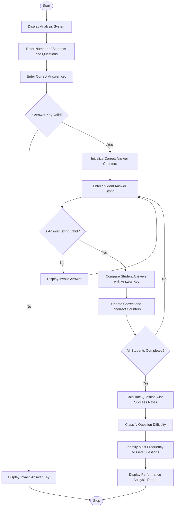

Examination Question Difficulty and Performance Analysis

1. Problem Statement

Develop a Python program called Examination Question Difficulty and Performance Analysis System to evaluate student examination performance by comparing their answers with the correct answer key.

The program should:
- Accept the number of students and examination questions.
- Store the correct answer key for all questions.
- Accept each student's answers as a string.
- Compare student answers with the correct answer key.
- Calculate the number of correct and incorrect answers for each question.
- Calculate the question-wise success rate (percentage of students who answered correctly).
- Identify the most frequently missed questions.
- Classify question difficulty based on success rates:
  - Easy: Success rate ≥ 75%.
  - Moderate: Success rate between 40% and 74%.
  - Difficult: Success rate below 40%.
- Display a detailed performance analysis report.
- Validate answer strings and handle invalid inputs.

2. Algorithm

  
1. Start the program.
2. Display the Examination Question Difficulty and Performance Analysis title.
3. Ask the user to enter the number of students.
4. Ask the user to enter the number of examination questions.
5. Read the correct answer key.
6. Validate the answer key length.
7. Initialize question-wise correct answer counters to zero.
8. Accept answer strings from all students.
9. Validate each student's answer string.
10. Compare each student's answer with the correct answer key question by question.
11. If the answer is correct, increase the corresponding question's correct count.
12. If the answer is incorrect, increase the corresponding question's incorrect count.
13. Calculate the success rate for each question:
\[
\text{Success Rate} =
\frac{\text{Correct Answers}}{\text{Total Students}}\times100
\]

14. Classify each question:
    - Easy: Success rate ≥ 75%.
    - Moderate: Success rate ≥ 40% and below 75%.
    - Difficult: Success rate below 40%.
15. Identify the question with the highest incorrect answer count.
16. Display the question-wise analysis report.
17. Display the most frequently missed question.
18. Stop the program.

Sample input
EXAMINATION QUESTION DIFFICULTY AND PERFORMANCE ANALYSIS
--------------------------------------------------------

Enter number of students: 5
Enter number of questions: 5

Enter correct answer key: ABCDA

Enter answers of each student:

Student 1: ABCDA
Student 2: ABCBA
Student 3: ADCDA
Student 4: BBCDA
Student 5: ABCDB

Sample output
EXAMINATION PERFORMANCE ANALYSIS REPORT
--------------------------------------------------------

Total Students: 5
Total Questions: 5
Correct Answer Key: ABCDA

QUESTION-WISE PERFORMANCE
--------------------------------------------------------
Question   Correct   Incorrect   Success Rate   Difficulty
--------------------------------------------------------
Q1           4          1           80%           Easy
Q2           3          2           60%           Moderate
Q3           4          1           80%           Easy
Q4           5          0          100%           Easy
Q5           3          2           60%           Moderate
--------------------------------------------------------

MOST FREQUENTLY MISSED QUESTIONS:
Q2 - 2 incorrect answers
Q5 - 2 incorrect answers

DIFFICULTY SUMMARY:
Easy Questions: 3
Moderate Questions: 2
Difficult Questions: 0

OVERALL PERFORMANCE:
Total Correct Answers: 19
Total Possible Answers: 25
Overall Success Rate: 76%

Thank You!
